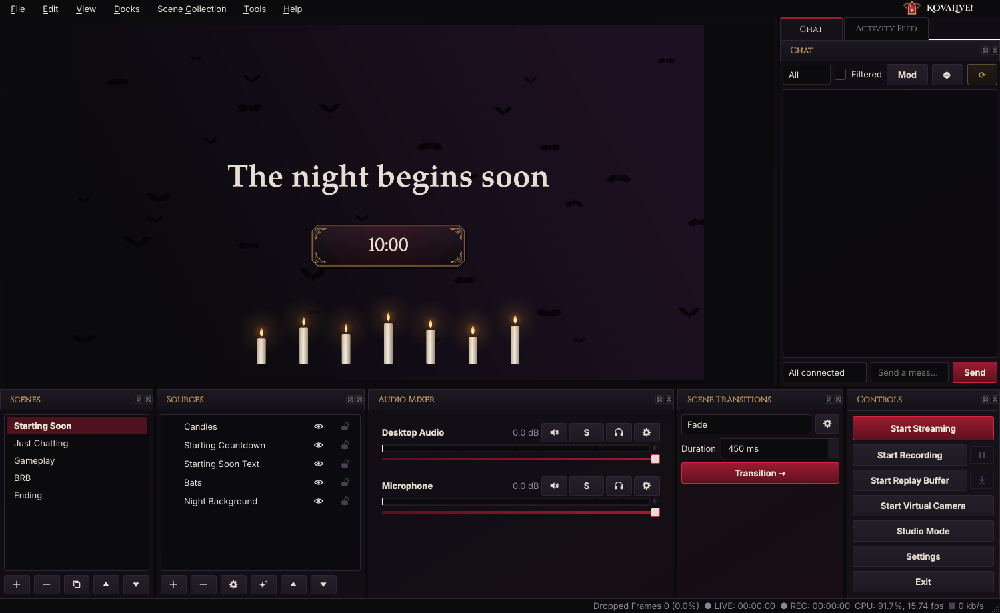
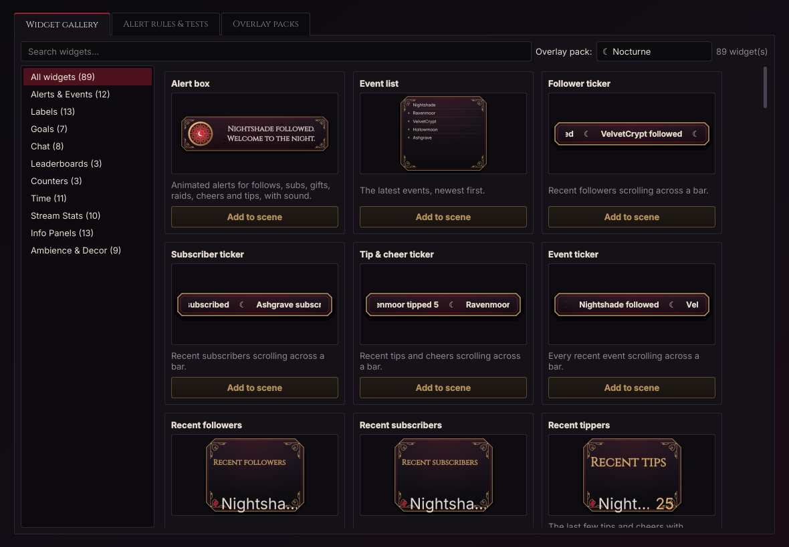
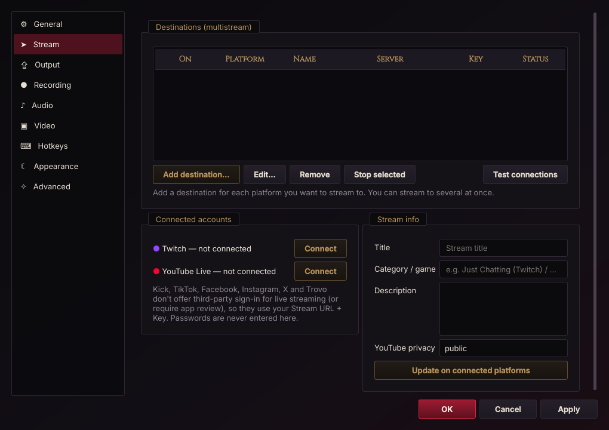
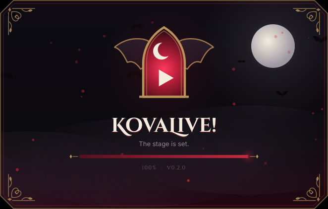
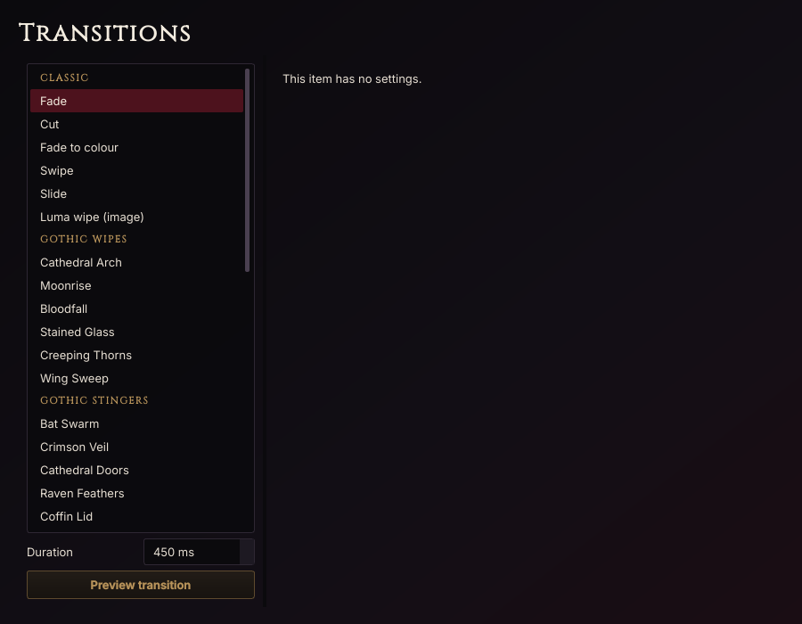
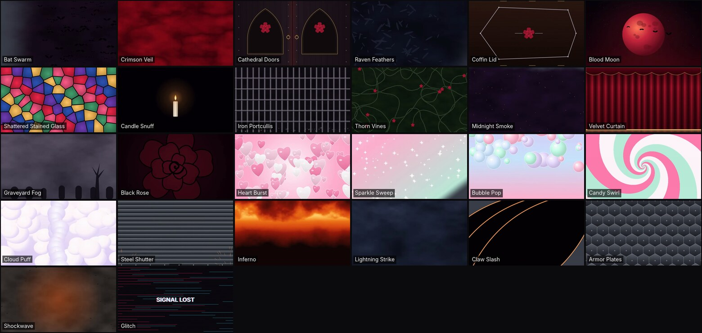

# KovaLive!

A native Windows live-streaming and recording studio with a gothic look: OBS-class scene
compositing on the OBS engine, multistreaming, recording, an audio mixer with VST 2 and VST3
plugins, 89 native widgets, 26 stinger transitions, and a window laid out like OBS / Streamlabs.



* **Native desktop app.** C++20 + Qt 6 Widgets for the UI, and **libobs** (OBS Studio's engine)
  for capture, compositing, encoding and output. No Electron, no web view, no Chromium.
* **Laid out like OBS / Streamlabs.** Preview on top; Scenes · Sources · Audio Mixer · Scene
  Transitions · Controls docked along the bottom; Chat on the right; File / Edit / View / Docks /
  Scene Collection / Tools / Help menus; Settings in its own window with categories down the left
  and OK / Cancel / Apply. Every dock can be moved, tabbed, popped out, locked and reset.
* **Real installer.** Inno Setup wizard in a dark theme. Handles the VC++ runtime, the virtual
  camera driver, upgrades, removal of the old "HeartCast Studio" install, and a clean uninstall.
* **Licence:** GPL. The Windows package is GPL-3.0 because it ships the GPL-3.0-or-later VST3 host.
  See [THIRD-PARTY-LICENSES](docs/THIRD-PARTY-LICENSES.md).

## Get the Windows .exe and installer

Windows binaries are built by GitHub Actions (`.github/workflows/windows-build.yml`):

1. Open **Actions → Windows build → Run workflow** (or push to `main`). The first run compiles the
   OBS engine (~40 min). Later runs reuse a cache.
2. Download the artifact **KovaLive-<version>-windows-x64**. It contains:
   * `KovaLive-<version>-Setup.exe`: the installer
   * `KovaLive-<version>-portable.zip`: unzip and run `bin\64bit\KovaLive.exe`
3. Push a tag like `v0.2.0` to publish a GitHub Release. This also creates the `update.json` feed
   that the in-app updater reads.

To build by hand on Windows, see [BUILD-INSTRUCTIONS](docs/BUILD-INSTRUCTIONS.md).

## Feature status (honest)

Legend: ✅ implemented and exercised by automated tests against real libobs ·
🟢 implemented, verified by running the app · 🔑 needs your developer credentials ·
🖥️ needs specific hardware or drivers · 🚧 limited by the platform's API · ⏳ not yet implemented

| Area | Status | Notes |
|---|---|---|
| Native window, gothic theme (Nocturne palette, Cinzel + Inter fonts), animated splash with real progress | 🟢 | Animations can be turned off and pause while live |
| First-run wizard (beginner / advanced, device checks, profiles) | 🟢 | Camera preview, mic meter, test tone, encoder pick |
| OBS / Streamlabs layout: bottom docks, right-hand chat, OBS-style menus, status bar with LIVE/REC timers, CPU, FPS, dropped frames, kb/s | 🟢 | |
| Docks: drag, tab, float, nest, lock, reset, saved layouts | 🟢 | Scenes, Sources, Audio Mixer, Scene Transitions, Controls, Chat, Activity Feed, Stats |
| Settings window: General, Stream, Output, Recording, Audio, Video, Hotkeys, Appearance, Advanced; OK / Cancel / Apply | 🟢 | |
| Scenes: create, rename, duplicate, delete, reorder, hotkeys, scene collections (new, duplicate, import, export, switch) | ✅ | |
| Sources: every libobs input type, properties, transform, crop, rotate, lock, hide, group, duplicate, z-order | ✅ / 🟢 | Display/window/game capture, webcam, capture card, media, image, slideshow, text, colour, gradient, audio |
| Preview editing: drag, corner-resize, snapping + guides, safe areas, nudge, undo/redo | 🟢 | |
| Studio mode (preview → program), fullscreen projector | 🟢 | |
| Transitions: cut, fade, fade-to-colour, swipe, slide, luma wipe (your image), your own stinger video | ✅ | |
| **6 gothic wipes** (Cathedral Arch, Moonrise, Bloodfall, Stained Glass, Creeping Thorns, Wing Sweep) | ✅ | Native libobs transition with soft and glowing edges; test renders each one halfway |
| **26 stinger transitions**: 14 gothic, 5 cute, 7 bold | ✅ | VP9 WebM with transparency. The test plays every one in libobs and checks the screen is fully covered at the cut and lands on the new scene |
| Encoders: x264, NVENC, AMD AMF, Intel QSV, H.264 / HEVC / AV1 (whatever the PC supports) | ✅ x264 · 🖥️ GPU encoders | Auto-detected; CBR / VBR / CQP, keyframe interval, preset, profile, B-frames |
| **Multistream:** N destinations from one shared encode, optional per-destination bitrate | ✅ | Test streams to 2 local RTMP servers at once |
| Reconnect, per-destination errors, bandwidth estimate, connection test | ✅ / 🟢 | |
| Recording: MKV/MP4/MOV/FLV/TS, quality presets, up to 6 audio tracks, pause/resume, auto-record, MKV→MP4 remux | ✅ | |
| Replay buffer + save hotkey | ✅ | |
| Audio mixer: volume, mute, solo, monitoring, sync offset, balance, mono, tracks, peak meters, clip indicator | 🟢 | |
| Audio filters: noise suppression, gate, expander, compressor, limiter, gain, EQ, presets | 🟢 | |
| **VST 2.x and VST3 plugins** | ✅ loading (Windows CI) · 🖥️ your plugins | obs-vst (VST 2) and the vendored obs-vst3 host; the Windows engine test checks both load. Using a real plugin and its editor needs a plugin installed on your PC; not exercised by CI |
| AI background removal | 🖥️ | Needs the NVIDIA Video Effects SDK (RTX) or the obs-backgroundremoval plugin |
| **89 native widgets** in a searchable gallery (alerts, labels, goals, chat polls / giveaways / Q&A, leaderboards, counters, clocks and timers, stream stats, audio-reactive sigil and visualizer, info panels, ambience) | ✅ / 🟢 | Drawn natively and pushed as video frames; no browser source. The test adds every widget, feeds it chat, events and commands, and checks it renders |
| Widget hotkeys and chat commands (`!vote`, `!join`, `!q`, counter keywords, `!win` / `!loss`) | ✅ commands · 🟢 hotkeys | |
| 8 gothic overlay packs | 🟢 | Nocturne, Crimson Cathedral, Velvet Requiem, Bone & Ash, Blood Moon, Absinthe, Gilded Crypt, Ravenwing |
| Media library: folders, search, filter, tags, import, drag-and-drop, starter assets | 🟢 | |
| Twitch: OAuth device flow, stream key, title/category, IRC chat, EventSub alerts, moderation | 🔑 | Needs a free Twitch Client ID (Tools → Developer Credentials; see [API-INTEGRATIONS](docs/API-INTEGRATIONS.md)). Not exercised against live Twitch here |
| YouTube: OAuth PKCE, broadcast creation and binding, title/description, chat, Super Chat/membership alerts, moderation | 🔑 | Needs a Google OAuth client. Not exercised against live YouTube here |
| Kick, TikTok LIVE, Facebook, Instagram, X, Trovo, custom RTMP/RTMPS/SRT | 🚧 | Stream URL + key (what these platforms allow third-party apps to use) |
| Unified chat filters (blocked words, flood, repeats, caps) | ✅ | |
| Global hotkeys with conflict detection | 🟢 | Global (system-wide) on Windows via RegisterHotKey |
| Virtual camera ("KovaLive Virtual Camera") | 🖥️ | Driver registered by the installer; reports a clear message if missing |
| Plugins: libobs modules + app plugin API with permissions, SHA-256 and Authenticode checks | 🟢 | Plugins run in-process. Permissions limit the API but are **not** a sandbox |
| Secure token / stream-key storage (Windows DPAPI) | 🟢 | Keys never touch config files or exports |
| Updater: HTTPS feed, SHA-256 + Authenticode check, rollback copy | 🟢 | Refuses unsigned installers on Windows (see BUILD docs on signing) |
| Crash handling: minidumps, recovery notice, atomic saves, corrupt-config fallback | ✅ / 🟢 | |
| Scene *folders*, Kick/Facebook chat, media-request widget, NDI, browser sources, translations | ⏳ | NDI/browser can be added as libobs plugins |

**What was actually tested:** every push runs automated tests on Windows and Linux. On **Windows**
(GitHub's Windows Server 2025 image, Direct3D 11 on Microsoft's software GPU) the packaged build
passes the engine test under full page-heap checking: libobs startup and plugins, both VST hosts
loading, starter scenes, scene save/load, recording, pause/resume, replay buffer, all stingers and
wipes, all widgets, error reporting, virtual-camera detection and clean shutdown. On **Linux** the
same engine also streams one shared encode to **two RTMP servers at once**, and both receive
H.264 + AAC. Not yet exercised: real GPU encoders, webcams, game capture, real VST plugins and
their editors, global hotkeys, DPAPI key storage on a real desktop, the installer UI, and live
Twitch/YouTube accounts.
Builds are **not code-signed** until you add Azure Artifact Signing (see BUILD docs).

## Screenshots
| | |
|---|---|
|  |  |
|  |  |
|  |  |

## Documentation
* [USER-GUIDE](docs/USER-GUIDE.md): using the studio
* [INSTALLATION-GUIDE](docs/INSTALLATION-GUIDE.md): installing, upgrading (incl. from HeartCast Studio), uninstalling
* [BUILD-INSTRUCTIONS](docs/BUILD-INSTRUCTIONS.md): Windows/CI/Linux builds, Qt and VST3 SDK versions, art generation, signing
* [API-INTEGRATIONS](docs/API-INTEGRATIONS.md): platform credentials, scopes and limitations
* [PLUGIN-API](docs/PLUGIN-API.md): writing plugins
* [THIRD-PARTY-LICENSES](docs/THIRD-PARTY-LICENSES.md)

## Project layout
```
src/app        theme, fonts, build info       src/engine     libobs wrapper, gothic wipes, widget source
src/core       settings, logging, crash, HW,  src/overlays   widget catalog, renderer, live data
               hotkeys, paths                 src/platforms  Twitch, YouTube, hub, catalog
src/auth       OAuth (device, PKCE), DPAPI    src/plugins    plugin API + manager
src/ui         main window, docks, settings,  src/updater    secure updater
               gallery, wizard, icons, art
third_party/   obs-vst3 (VST3 host, GPL-3.0-or-later)
resources/     theme QSS, fonts, icons, stingers, packs, scenes, platform catalog, Windows .rc/.ico
installer/     Inno Setup script + wizard art  tools/  art generator, asset script, Windows packager
tests/         unit tests + libobs integration test (recording, replay, multistream, stingers, widgets)
```
