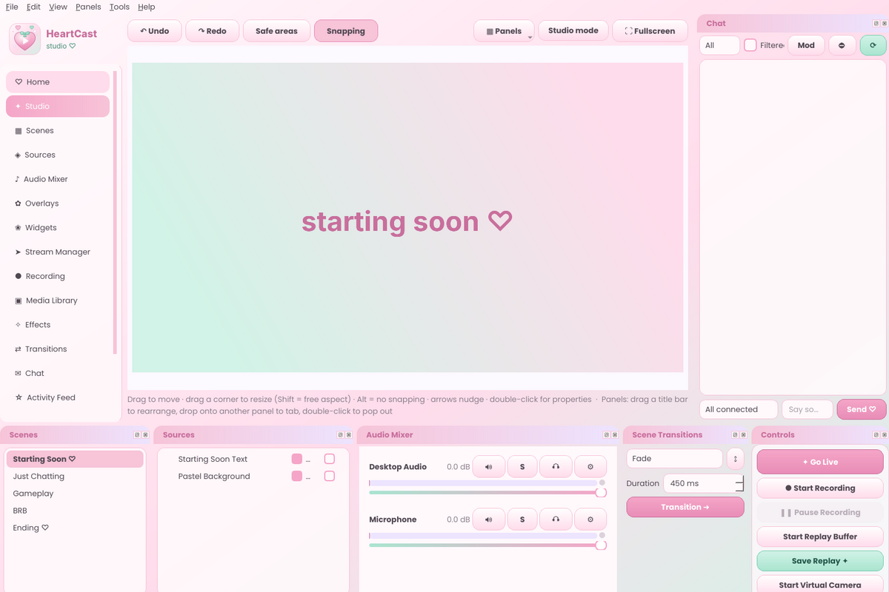
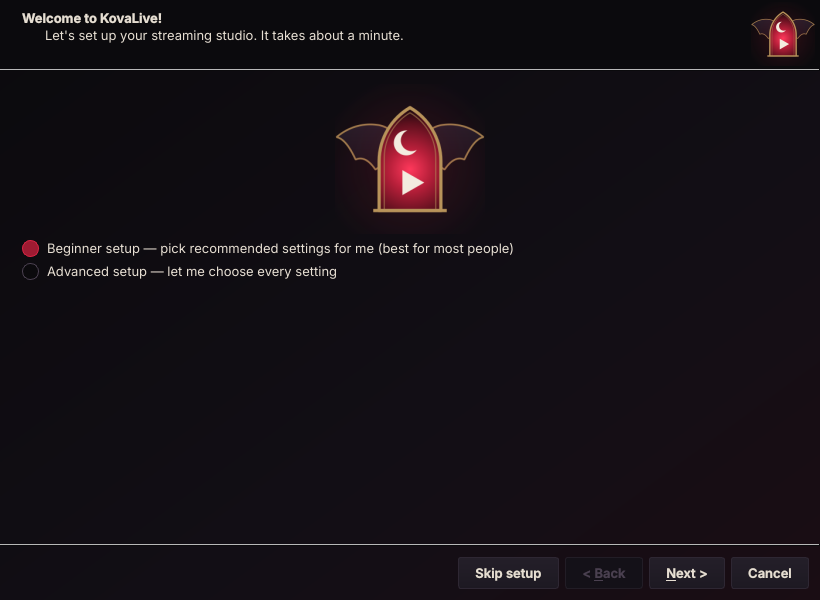
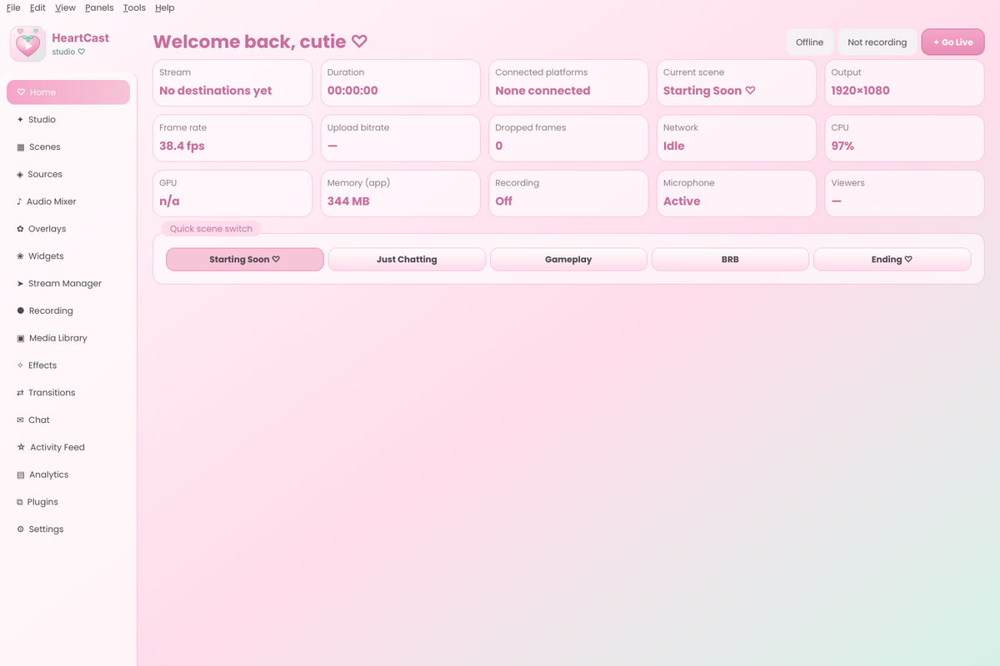
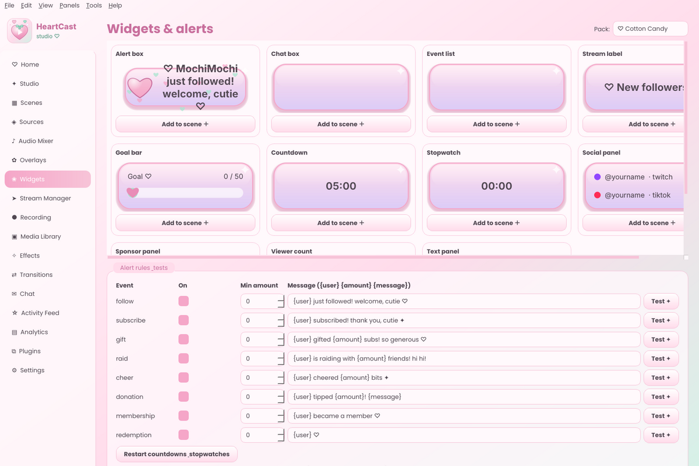
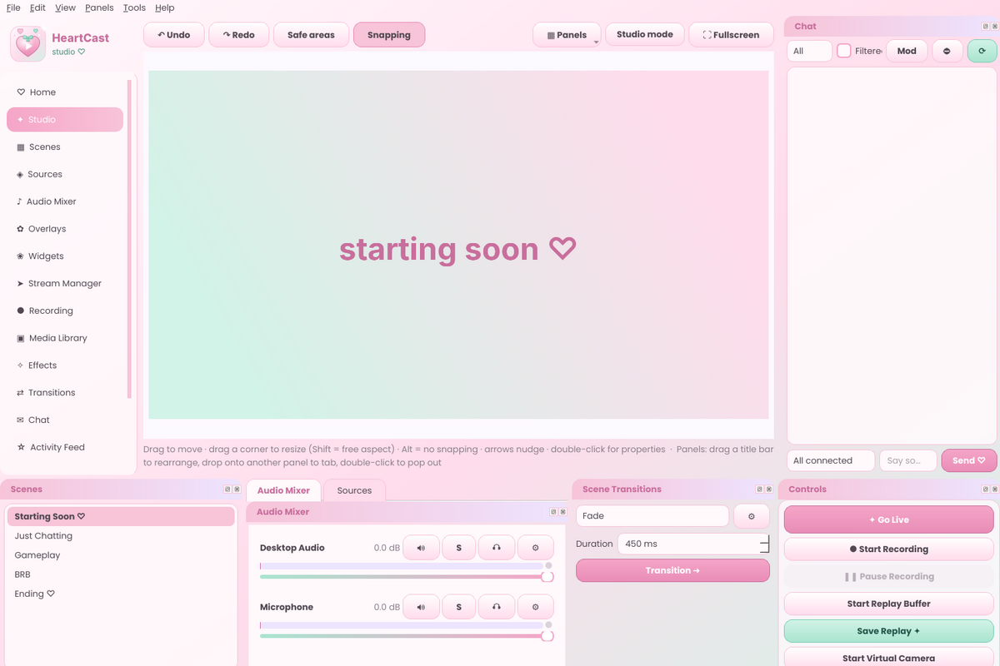
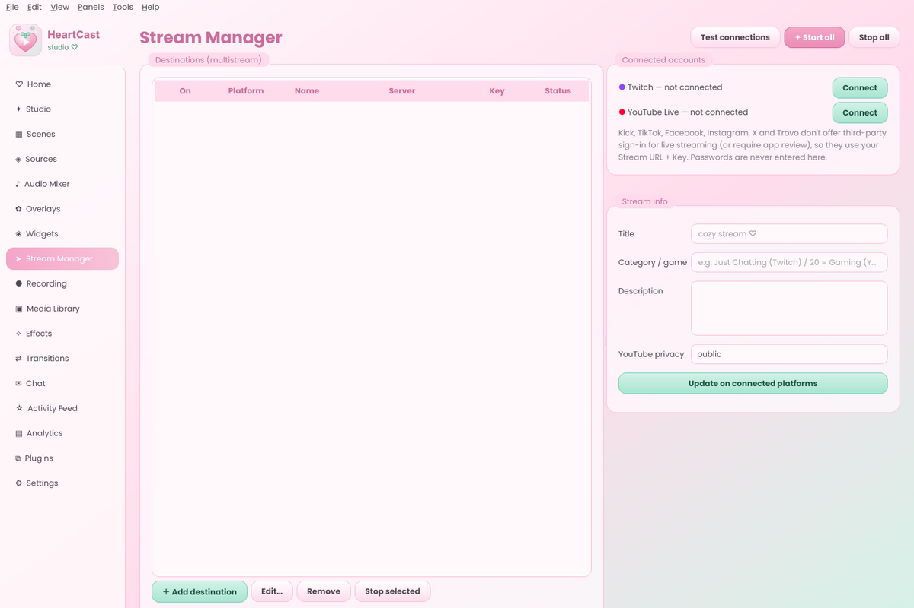

# HeartCast Studio ♡

A native Windows live-streaming and recording studio with a pastel kawaii look:
OBS-class scene compositing, multistreaming, recording, an audio mixer, native
alerts and widgets, and a dockable workspace like OBS / PRISM Live Studio.



* **Native desktop app.** C++20 + Qt 6 Widgets for the UI, and **libobs** (OBS Studio's engine)
  for capture, compositing, encoding and output. No Electron, no web view, no Chromium.
* **Real installer.** Inno Setup wizard in the same pink/mint theme. Handles the VC++ runtime,
  the virtual camera driver, upgrades and a clean uninstall.
* **Licence:** GPL-2.0-or-later, because libobs is GPL. See [THIRD-PARTY-LICENSES](docs/THIRD-PARTY-LICENSES.md).

## Get the Windows .exe and installer

Windows binaries are built by GitHub Actions (`.github/workflows/windows-build.yml`):

1. Push this folder to a GitHub repository.
2. Open **Actions → Windows build → Run workflow**. The first run compiles the OBS engine
   (~40 min). Later runs reuse a cache.
3. Download the artifact **HeartCastStudio-<version>-windows-x64**. It contains:
   * `HeartCastStudio-<version>-Setup.exe`: the installer
   * `HeartCastStudio-<version>-portable.zip`: unzip and run `bin\64bit\HeartCastStudio.exe`
4. Push a tag like `v0.1.0` to publish a GitHub Release. This also creates the
   `update.json` feed that the in-app updater reads.

To build by hand on Windows, see [BUILD-INSTRUCTIONS](docs/BUILD-INSTRUCTIONS.md).

## Feature status (honest)

Legend: ✅ implemented and exercised by automated tests against real libobs ·
🟢 implemented, verified by running the app · 🔑 needs your developer credentials ·
🖥️ needs specific hardware or drivers · 🚧 limited by the platform's API · ⏳ not yet implemented

| Area | Status | Notes |
|---|---|---|
| Native window, theme, animated splash (real progress + hang watchdog) | 🟢 | Animations can be turned off; decorations pause while live |
| First-run wizard (beginner / advanced, device checks, profiles) | 🟢 | Camera preview, mic meter, test tone, encoder pick |
| Dockable workspace: drag, tab, float, nest, lock, reset, saved layouts | 🟢 | Scenes, Sources, Mixer, Transitions, Controls, Chat, Activity, Stats |
| Scenes: create, rename, duplicate, delete, reorder, hotkeys, save/import/export collections | ✅ | |
| Sources: every libobs input type, properties, transform, crop, rotate, lock, hide, group, duplicate, z-order | ✅ / 🟢 | Display/window/game capture, webcam, capture card, media, image, slideshow, text, colour, gradient, audio |
| Preview editing: drag, corner-resize, snapping + guides, safe areas, nudge, undo/redo | 🟢 | |
| Studio mode (preview → program), fullscreen projector | 🟢 | |
| Transitions: cut, fade, fade-to-colour, swipe, slide, luma wipe, stinger + 4 original kawaii wipes | ✅ | Heart Iris, Star Burst, Ribbon Sweep, Sparkle Dissolve |
| Encoders: x264, NVENC, AMD AMF, Intel QSV, H.264 / HEVC / AV1 (whatever the PC supports) | ✅ x264 · 🖥️ GPU encoders | Auto-detected; CBR / VBR / CQP, keyframe interval, preset, profile, B-frames |
| **Multistream:** N destinations from one shared encode, optional per-destination bitrate | ✅ | Test streams to 2 local RTMP servers at once; stopping one leaves the other running |
| Reconnect, per-destination errors, bandwidth estimate, connection test | ✅ / 🟢 | |
| Recording: MKV/MP4/MOV/FLV/TS, quality presets, up to 6 audio tracks, pause/resume, auto-record, MKV→MP4 remux | ✅ | |
| Replay buffer + save hotkey | ✅ | |
| Recording library: thumbnails, rename, export, remux, recycle | 🟢 | |
| Audio mixer: volume, mute, solo, monitoring, sync offset, balance, mono, tracks, peak meters, clip indicator | 🟢 | Global desktop and mic channels plus every audio source |
| Audio filters: noise suppression, gate, expander, compressor, limiter, gain, EQ, presets | 🟢 | VST 2 hosting: ⏳ (module doesn't load in the Windows build yet) |
| Video effects: colour correction, chroma/colour key, LUT, mask, crop, sharpen, scale | 🟢 | |
| AI background removal | 🖥️ | Needs the NVIDIA Video Effects SDK (RTX) or the obs-backgroundremoval plugin |
| Native widgets: alerts (queue, animation, sound in stream), chat box, event list, labels, goals, countdown, stopwatch, social/sponsor panels, viewer count, text panel | ✅ / 🟢 | Drawn natively and pushed as video frames; no browser source |
| 8 original overlay packs | 🟢 | Cotton Candy, Strawberry Milk, Mint Macaron, Pastel Dream, Pink Galaxy, Cherry Blossom, Magical Girl, Soft Academia |
| Media library: folders, search, filter, tags, import, drag-and-drop, starter assets | 🟢 | |
| Twitch: OAuth device flow, stream key, title/category, IRC chat, EventSub alerts, moderation | 🔑 | Needs a free Twitch Client ID, pasted in Settings → Advanced → Developer credentials ([API-INTEGRATIONS](docs/API-INTEGRATIONS.md)). Not exercised against live Twitch here |
| YouTube: OAuth PKCE, broadcast creation and binding, title/description, chat, Super Chat/membership alerts, moderation | 🔑 | Needs a Google OAuth client. Not exercised against live YouTube here |
| Kick, TikTok LIVE, Facebook, Instagram, X, Trovo, custom RTMP/RTMPS/SRT | 🚧 | Stream URL + key (what these platforms allow third-party apps to use) |
| Unified chat filters (blocked words, flood, repeats, caps) | ✅ | |
| Global hotkeys with conflict detection | 🟢 | Global (system-wide) on Windows via RegisterHotKey |
| Virtual camera ("HeartCast Virtual Camera") | 🖥️ | Driver registered by the installer; reports a clear message if missing |
| Plugins: libobs modules + app plugin API with permissions, SHA-256 and Authenticode checks | 🟢 | Plugins run in-process. Permissions limit the API but are **not** a sandbox |
| Secure token / stream-key storage (Windows DPAPI) | 🟢 | Keys never touch config files or exports |
| Updater: HTTPS feed, SHA-256 + Authenticode check, rollback copy | 🟢 | Refuses unsigned installers on Windows (see BUILD docs on signing) |
| Crash handling: minidumps, recovery notice, atomic saves, corrupt-config fallback | ✅ / 🟢 | |
| Scene *folders*, Kick/Facebook chat, music-now-playing and media-request widgets, NDI, browser sources, translations | ⏳ | NDI/browser can be added as libobs plugins |

**What was actually tested:** every push runs automated tests on both Windows and Linux.
On **Windows** (GitHub's Windows Server 2025 image, Direct3D 11 on Microsoft's software GPU) the packaged
build passes the engine test under full page-heap checking: libobs startup and plugins, starter scenes,
scene save/load, recording, pause/resume, replay buffer, error reporting, virtual-camera detection and
clean shutdown. On **Linux** the same engine also streams one shared encode to **two RTMP servers at once**,
and both receive H.264 + AAC. Not yet exercised: real GPU encoders, webcams, game capture, global hotkeys,
DPAPI key storage on a real desktop, the installer UI, and live Twitch/YouTube accounts.
**Known issue:** VST 2 audio plugins (obs-vst) don't load in the Windows build yet.
Builds are **not code-signed** until you add Azure Artifact Signing (see BUILD docs).

## Screenshots
| | |
|---|---|
|  |  |
|  |  |
|  |  |

## Documentation
* [BUILD-INSTRUCTIONS](docs/BUILD-INSTRUCTIONS.md): Windows/CI/Linux builds, signing, renaming
* [INSTALLATION-GUIDE](docs/INSTALLATION-GUIDE.md): installing, upgrading, uninstalling
* [USER-GUIDE](docs/USER-GUIDE.md): using the studio
* [API-INTEGRATIONS](docs/API-INTEGRATIONS.md): platform credentials, scopes and limitations
* [PLUGIN-API](docs/PLUGIN-API.md): writing plugins
* [THIRD-PARTY-LICENSES](docs/THIRD-PARTY-LICENSES.md)

## Project layout
```
src/app        theme, build info              src/engine     libobs wrapper, widget source
src/core       settings, logging, crash, HW,  src/overlays   native widget/alert renderer
               hotkeys, paths                 src/platforms  Twitch, YouTube, hub, catalog
src/auth       OAuth (device, PKCE), DPAPI    src/plugins    plugin API + manager
src/ui         windows, docks, pages, wizard  src/updater    secure updater
resources/     theme QSS, icons, packs, scenes, platform catalog, Windows .rc/.manifest/.ico
installer/     Inno Setup script + wizard art  tools/  asset generator, Windows packager
tests/         unit tests + libobs integration test (recording, replay, multistream)
```
