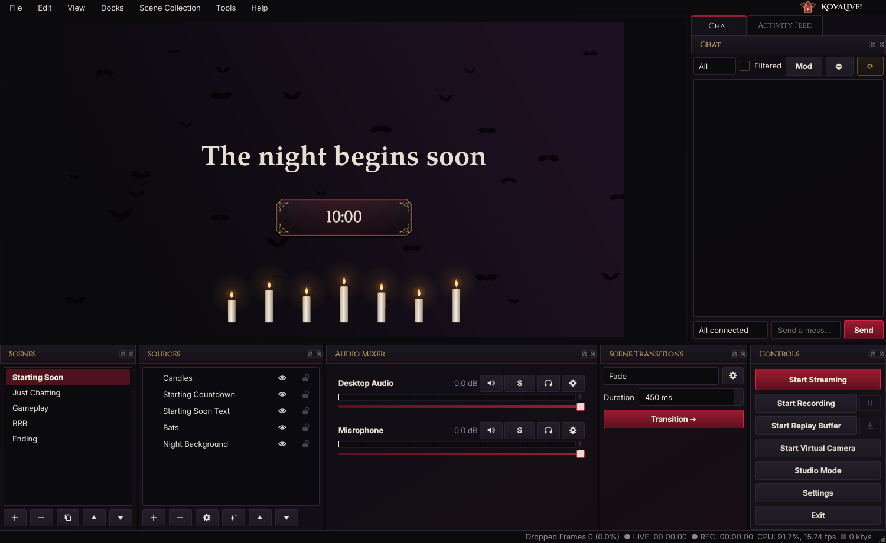
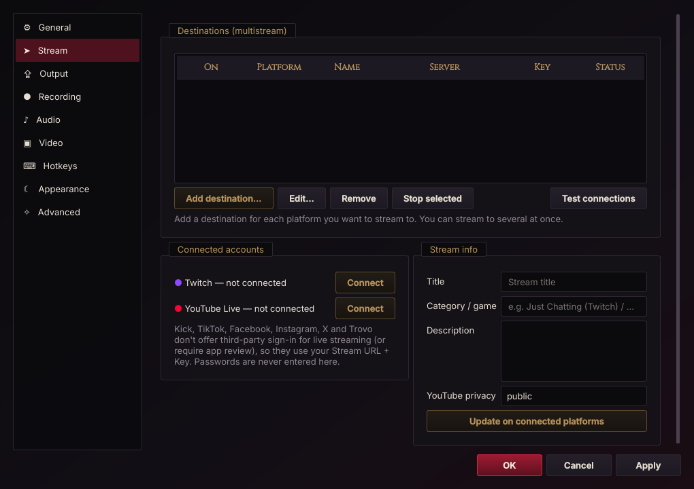
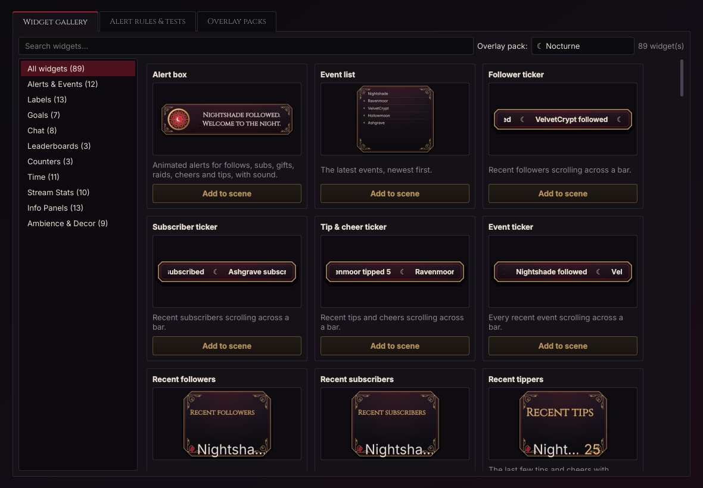
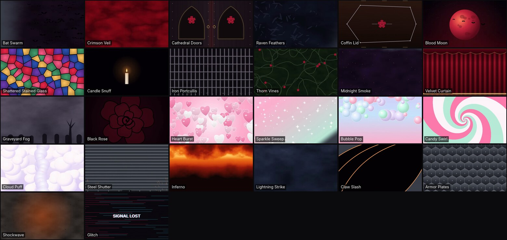

# KovaLive!: Getting Started

## 1. First launch
The splash screen shows real loading progress. The setup wizard then asks for:
* **Beginner** or **Advanced** mode. Beginner picks resolution, FPS and encoder from your hardware.
* Camera, microphone (with a live level meter) and speakers (with a test tone)
* Canvas size (landscape, vertical for TikTok/Shorts, or square), FPS and encoder (Advanced mode)
* Your first streaming destination and an accent colour

Run it again any time from **Tools → Auto-Configuration Wizard**.

If you used KovaLive under its old name (HeartCast Studio), your scenes, settings and saved stream
keys are copied over automatically the first time KovaLive starts.

## 2. The window (laid out like OBS / Streamlabs)

* **Preview** fills the top of the window. In **Studio Mode** a second picture (the program, what
  viewers see) appears next to it with a **Transition** button between them.
* **Docks along the bottom**, left to right: **Scenes**, **Sources**, **Audio Mixer**,
  **Scene Transitions** and **Controls** (Start Streaming, Start Recording + pause, Start Replay
  Buffer + save, Start Virtual Camera, Studio Mode, Settings, Exit).
* **Chat** is on the right, with **Activity Feed** as a tab behind it.
* **Status bar:** dropped frames, LIVE and REC timers, CPU and FPS, and upload bitrate with a
  health dot (green good, amber some loss, red heavy loss).

### Menus
| Menu | What's in it |
|---|---|
| File | Show Recordings, Open Recordings Folder, Settings, Show Settings Folder, Exit |
| Edit | Undo / Redo, Edit Transform (Ctrl+E), Fit to Screen (Ctrl+F), Snapping |
| View | Fullscreen Interface (F11), Studio Mode, Safe Areas, Status Bar, Fullscreen Projector (Ctrl+F11), Stream Analytics |
| Docks | Show/hide every dock, Lock Docks, Reset Docks, Save / Load / Delete Layout |
| Scene Collection | New, Duplicate, Import, Export, and switch between your collections |
| Tools | Widget Gallery, Media Library, Effects, Transitions, Chat & Moderation, Activity Feed, Plugins, Auto-Configuration Wizard, Microphone Test, Developer Credentials |
| Help | User Guide, Log Files, Crash Reports, Check for Updates, About |

### Rearranging docks
* **Move:** drag a dock's title bar to any edge. A highlight shows where it will land.
* **Tab together:** drop a dock onto another dock. They become tabs.
* **Pop out:** double-click the title bar or press its float button. Popped-out docks are normal
  windows you can put on a second monitor.
* **Lock Docks** (Docks menu) stops accidental drags while you're live. **Reset Docks** restores
  the layout above. **Save Layout As…** keeps named layouts, e.g. "Gaming" or "Just Chatting".

Your layout is saved automatically.

## 3. Scenes and sources
* **Scenes dock:** + add, − remove, duplicate, ▲▼ reorder, double-click to rename. Right-click
  for more.
* **Sources dock:** + opens every source type (Capture, Audio, Media & images, Text & creative,
  **Widgets**). The eye icon hides a source, the lock icon locks it. Right-click for transform,
  filters, duplicate, group and order.
* **In the preview:** click to select, drag to move, drag a corner to resize (hold **Shift** to
  ignore aspect ratio), **Alt** turns off snapping, arrow keys nudge (Shift = 10 px). Double-click
  opens properties. **Ctrl+Z / Ctrl+Y** undo and redo.
* **Fullscreen Projector** puts the program on your second monitor (Esc closes it).

The starter collection gives you five ready scenes: Starting Soon (bats, countdown, candles),
Just Chatting (webcam, chat box, alerts, follower goal), Gameplay, BRB and Ending.

## 4. Settings

**File → Settings** (or the Settings button in Controls) opens a separate window with categories
down the left, like OBS: **General, Stream, Output, Recording, Audio, Video, Hotkeys, Appearance,
Advanced**. **OK** saves and closes, **Cancel** throws away your changes, **Apply** saves and
keeps the window open.

## 5. Going live
1. **Settings → Stream → Add destination…**: pick the platform, paste the Stream URL and Key. Help
   text tells you where to find them. Keys are encrypted with Windows DPAPI.
2. Twitch and YouTube can be **connected** instead. Sign-in happens in your browser (KovaLive never
   sees your password); KovaLive then fetches the server and key, updates your title and category,
   and brings in chat and alerts. The first time you click **Connect**, KovaLive asks for a free
   **Client ID** that you register yourself (Twitch Developer Console, or Google Cloud for
   YouTube). The window walks you through it and has buttons that open the right console. You can
   change it later in **Tools → Developer Credentials** or **Settings → Advanced**.
3. Add more destinations to **multistream**. Destinations at the default bitrate share one encode.
   Tick "different bitrate" only when a platform needs a lower one.
4. Press **Start Streaming** in Controls. Each destination shows its own status, bitrate and
   dropped frames in Settings → Stream, where you can also stop one without stopping the others.
5. **Test connections** (Settings → Stream) helps when something won't connect.

## 6. Recording
**Start Recording** in Controls. MKV is the default because it survives crashes; an MP4 copy is
made automatically when you stop. You get pause/resume, up to 6 audio tracks (per-source tracks
are under Mixer ⚙ → Advanced), and a **replay buffer** (save it with the button next to it or a
hotkey). **File → Show Recordings** lists every file with thumbnails, rename, export, remux and
delete.

## 7. Audio mixer and VST plugins
Each source has a fader, mute, **S**olo, monitoring (headphones) and ⚙ (filters, sync offset,
balance, mono, tracks). The meter shows level and peak; a red dot means clipping.
**Tools → Microphone Test** helps you set levels and add noise suppression or a compressor.

**VST plugins** (Windows): open a source's filters (⚙ in the mixer, or right-click the source →
Filters), press **+** and choose **VST 2.x Plug-in filter** or **VST3 Plugin**, pick your plugin,
then press **Open Plug-in Interface** (VST 2) or **Open/Close VST3 Editor** to show its own window.
**Rescan VST3 list** picks up plugins you installed while KovaLive was open.
* VST 2 plugins are found in `C:\Program Files\VSTPlugins`, `C:\Program Files\Steinberg\VstPlugins`,
  `C:\Program Files\Common Files\VST2` and `…\Common Files\Steinberg\VST2`.
* VST3 plugins are found in `C:\Program Files\Common Files\VST3` and
  `%LOCALAPPDATA%\Programs\Common\VST3`. They are scanned by a separate helper program, so a broken
  plugin can't crash KovaLive while it's being scanned.
* Only 64-bit plugins load. Plugins run inside KovaLive, so only install ones you trust.

## 8. Widgets (89 of them)

**Tools → Widget Gallery** (or **Sources → + → Widgets → Widget Gallery…**) shows every widget
with a live preview, grouped into ten categories with a search box. Pick an **overlay pack**
(Nocturne, Crimson Cathedral, Velvet Requiem, Bone & Ash, Blood Moon, Absinthe, Gilded Crypt,
Ravenwing) and press **Add to scene**. Double-click a widget in Sources to customise it.

| Category | Widgets |
|---|---|
| Alerts & Events | Alert box, event list, follower / subscriber / tip / all-event tickers, recent followers / subscribers / tippers, raid banner, hype meter, sub combo |
| Labels | Latest follower, subscriber, gifter, raider, cheer, tip, member, redemption; followers / subs / bits / tips / chatters this stream |
| Goals | Follower, sub, tip, bits and chat goals, ring goal, candle goal |
| Chat | Chat box, chat bubble, chat marquee, **chat poll** (`!vote 1`), **giveaway** (`!join`), **Q&A board** (`!q your question`), word counter, first chatter |
| Leaderboards | Top gifters, top tippers, top chatters (this stream) |
| Counters | Death counter, kill counter, win / loss tracker |
| Time | Clock, gothic analog clock, date, world clock, countdown, starting-soon countdown, countdown to a date, stream uptime, subathon timer, pomodoro, moon phase |
| Stream Stats | Viewer count, ON AIR sign, REC indicator, stream health, bitrate graph, FPS meter, CPU meter, current scene, voice sigil (glows when you talk), audio visualizer |
| Info Panels | Social, sponsor, text panel, schedule, rotating messages, chat rules, lower third, scrolling banner, now playing, text from file, image slideshow, hydration and stretch reminders |
| Ambience & Decor | Bats, embers, rose petals, fog, falling ash, feathers, candle row, gothic webcam frame, ornament divider |

Tips:
* **Font size 0 = automatic**: text fills the widget. Set a number to fix the size.
* Counters, win/loss, giveaway, Q&A and subathon widgets have **buttons in their properties**
  (+1, −1, Reset, Draw winner, Next question, +5 minutes) and **hotkeys** (Settings → Hotkeys →
  Widgets). Mods can change a counter by typing its keyword in chat (`!death`, `!death-`);
  mods can type `!win` / `!loss` for the win/loss tracker.
* **Now playing / Text from file** read a text file that your music app or another tool writes
  (for example Tuna or Snip) and update when the file changes.
* **Voice sigil / audio visualizer** follow the audio source you pick in their properties.
* Ambience widgets only animate while their scene is on screen, so they cost nothing otherwise.
* **Alert rules & tests** (second tab): turn each event type on or off, set a minimum amount, edit
  the message (`{user}`, `{amount}`, `{message}`) and fire a test alert. Alert sounds are mixed
  into your stream.

Platform data (followers, subs, tips, chat) needs a connected Twitch or YouTube account; until
then widgets show "waiting" text in the stream and sample data only in the gallery.

## 9. Transitions

Pick a transition in the **Scene Transitions** dock or **Tools → Transitions** (with a preview
button). Available:
* **Classic:** Fade, Cut, Fade to colour, Swipe, Slide, Luma wipe (your own image)
* **Gothic wipes:** Cathedral Arch, Moonrise, Bloodfall, Stained Glass, Creeping Thorns, Wing Sweep
  (soft edge, glowing edge colour, invert)
* **26 stingers** (full-screen animations; the scene switches while the screen is fully covered):
  * Gothic: Bat Swarm, Crimson Veil, Cathedral Doors, Raven Feathers, Coffin Lid, Blood Moon,
    Shattered Stained Glass, Candle Snuff, Iron Portcullis, Thorn Vines, Midnight Smoke,
    Velvet Curtain, Graveyard Fog, Black Rose
  * Cute: Heart Burst, Sparkle Sweep, Bubble Pop, Candy Swirl, Cloud Puff
  * Bold: Steel Shutter, Inferno, Lightning Strike, Claw Slash, Armor Plates, Shockwave, Glitch
* **Your own stinger video…**: any video file (WebM with transparency or MP4), with your own cut point.

## 10. Chat and activity
The Chat dock merges Twitch and YouTube; **Tools → Chat & Moderation** opens a bigger version.
Right-click a message to delete it, time out or ban the user, or block them. Only actions the
platform actually allows are shown. **Blocked words** and automatic flood, repeat and all-caps
filtering hide messages locally. The Activity Feed lists follows, subs, gifts, raids, cheers,
Super Chats and memberships.

## 11. Effects
**Tools → Effects:** colour correction, chroma key, LUTs, masks, crop, sharpen; noise suppression,
gate, compressor and EQ for the mic. AI background removal needs an NVIDIA RTX GPU (Video Effects
SDK) or the obs-backgroundremoval plugin.

## 12. Hotkeys
**Settings → Hotkeys**. On Windows, hotkeys are global, so they work while your game has focus.
Conflicts with other actions, or with keys another program already owns, are shown immediately.
Actions: start/stop streaming, recording, pause, replay buffer and save, virtual camera,
mute/unmute/toggle mic, switch to any scene, show/hide the selected source, play/pause media,
test alert, and widget actions (counters +1/−1/reset, win, loss, giveaway draw, next Q&A
question, subathon +5 minutes).

## 13. Virtual camera
**Start Virtual Camera**, then choose "KovaLive Virtual Camera" in Discord, Zoom, Teams or Meet.
The camera driver is registered by the installer (needs "Install for all users").

## 14. Performance tips
* Use a GPU encoder (NVENC, AMF or QSV) when you game and stream on the same PC.
* **Settings → Output → Performance profile** applies sensible defaults for your PC class.
* Decorative animations pause automatically while you're live (Settings → General).
* Watch the status bar and the **Stats** dock (Docks menu). Render lag means the GPU is busy;
  encoder skips mean the encoder is overloaded; dropped frames mean your network is the bottleneck.
